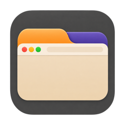
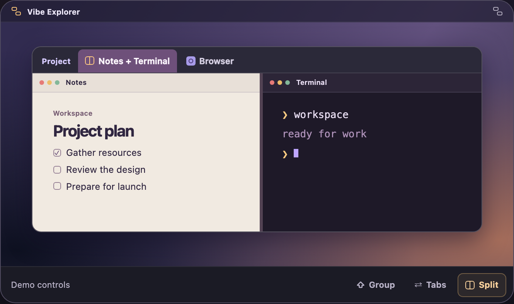

  

<h1 align="center">Vibe Explorer</h1>

<strong>Mac windows in tabs.</strong>

  <a href="https://github.com/Vladislav4er/vibe-explorer-releases/releases/latest"><strong>Download for Mac</strong></a>
  · <a href="https://vladislav4er.github.io/vibe-explorer-releases/en/features/">Explore the features</a>
  · <a href="https://github.com/Vladislav4er/vibe-explorer-releases/blob/main/README.ru.md">Русский</a>

Apple silicon · macOS 14 or later

Vibe Explorer groups windows from different Mac apps into a single tab bar. Organize them by project or task, switch between them like browser tabs, and keep two windows open together in a split tab.

  
   
  <a href="https://vladislav4er.github.io/vibe-explorer-releases/en/#demo">Try the interactive demo</a>

## What you can do

- **Group windows by task.** Hold Shift and drag one window onto another to start a group. Reorder tabs or drag them between groups.
- **Put two apps in one tab.** Open them side by side or one above the other, resize the split, and switch to other tabs without losing the pair.
- **Pick up where you left off.** Open saved groups from the menu bar. Move a group between desktops or monitors with its windows.
- **Make the tab bar your own.** Choose a light or dark theme, or let the bar match the active window. Hover over a tab for a preview.

## Get started

1. Download the Apple silicon ZIP from the [latest release](https://github.com/Vladislav4er/vibe-explorer-releases/releases/latest). Unzip it, move the app to **Applications**, and open it.
2. Enable the app in **System Settings → Privacy & Security → Accessibility** so it can manage windows. Screen recording permission is optional and enables tab previews and dynamic tab bar colors.
3. Open two app windows, then hold **Shift** and drag one window by its title bar onto the other.

The current builds use a local signing certificate. macOS may ask you to confirm the first launch. [Apple's first-launch instructions](https://support.apple.com/en-us/102445)

## Updates

Use **Check for Updates…** from the app menu, or enable automatic installation in Settings. Sparkle verifies signatures on the update feed and download. See what ships in each build in [GitHub Releases](https://github.com/Vladislav4er/vibe-explorer-releases/releases).

Vladislav Karetko · [LinkedIn](https://www.linkedin.com/in/karetko/)
