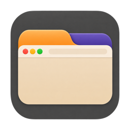
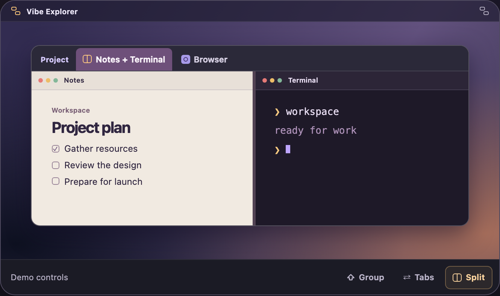

  

<h1 align="center">Vibe Explorer</h1>

<strong>Окна Mac во вкладках.</strong>

  <a href="https://github.com/Vladislav4er/vibe-explorer-releases/releases/latest"><strong>Скачать для Mac</strong></a>
  · <a href="https://vladislav4er.github.io/vibe-explorer-releases/features/">Все возможности</a>
  · <a href="https://github.com/Vladislav4er/vibe-explorer-releases">English</a>

Apple Silicon · macOS 14 и новее

Vibe Explorer собирает окна разных приложений Mac под одной панелью. Группируйте их по проектам и задачам, переключайтесь между ними как между вкладками в браузере и держите два окна рядом в одной вкладке.

  
   
  <a href="https://vladislav4er.github.io/vibe-explorer-releases/#demo">Попробовать интерактивное демо</a>

## Возможности

- **Группы по задачам.** Зажмите Shift и перетащите окно на другое, чтобы создать группу. Меняйте порядок вкладок и переносите их между группами.
- **Два окна в одной вкладке.** Располагайте их рядом или друг над другом, меняйте размеры областей и возвращайтесь к той же паре после переключения вкладок.
- **Доступ к рабочим группам.** Открывайте сохранённые группы из строки меню и переносите их вместе с окнами между рабочими столами и мониторами.
- **Настраиваемая панель.** Выберите светлую, тёмную или динамическую тему под цвет активного окна. Наведите курсор на вкладку, чтобы увидеть превью.

## Как начать

1. Скачайте ZIP для Apple Silicon из [последнего релиза](https://github.com/Vladislav4er/vibe-explorer-releases/releases/latest). Распакуйте его, перенесите приложение в папку **«Программы»** и откройте.
2. Включите Vibe Explorer в разделе **«Системные настройки → Конфиденциальность и безопасность → Универсальный доступ»**, чтобы приложение могло управлять окнами. Запись экрана нужна только для превью и динамической темы.
3. Откройте два окна. Зажмите **Shift** и перетащите одно за заголовок на другое.

Текущие сборки подписаны локальным сертификатом. macOS может запросить подтверждение первого запуска. [Инструкция Apple](https://support.apple.com/ru-ru/102445)

## Обновления

Пункт **«Проверить обновления…»** есть в меню приложения. Автоматическую установку можно включить в разделе **«Настройки → Доступ и данные → Обновления»**. Sparkle проверяет подписи ленты обновлений и архива. Состав каждой поставки описан в [GitHub Releases](https://github.com/Vladislav4er/vibe-explorer-releases/releases).

Vladislav Karetko · [LinkedIn](https://www.linkedin.com/in/karetko/)
